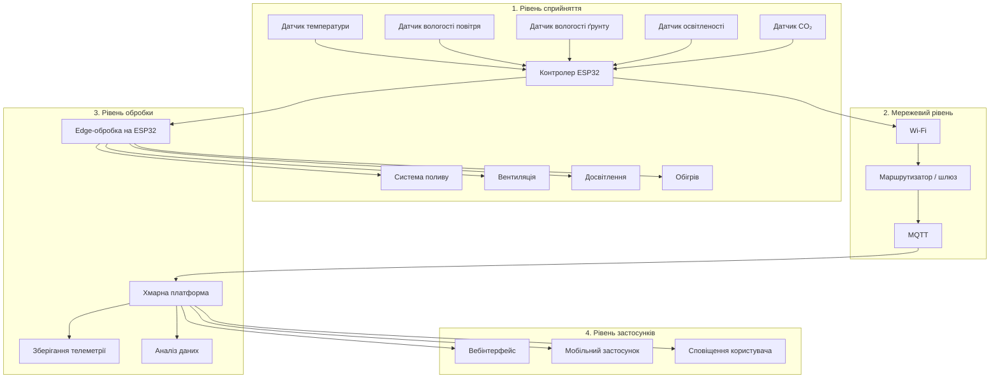

# Практична робота №1  
## Вступ до IoT та SMART-технологій

**Дисципліна:** Технології IoT та SMART-технології  
**Тема:** Вступ до IoT та SMART-технологій  
**Варіант:** 1 — Розумна теплиця  

---

## Мета роботи

Навчитися аналізувати та проєктувати IoT-систему на рівні архітектури: визначати склад пристроїв, обирати місце обробки даних, оцінювати ризики безпеки та обґрунтовувати технічні рішення відповідно до вимог поставленої задачі.

---

## 1. Опис системи

У межах практичної роботи проєктується IoT-система автоматичного контролю та керування теплицею площею **200 м²**.

Система повинна постійно отримувати інформацію про стан середовища в теплиці, аналізувати отримані дані та автоматично керувати обладнанням для підтримання необхідних умов вирощування рослин.

Контролюються такі параметри:

- температура повітря;
- вологість повітря;
- вологість ґрунту;
- рівень освітленості;
- концентрація CO₂.

На основі отриманих даних система автоматично керує:

- поливом;
- вентиляцією;
- досвітленням;
- обігрівом.

Система є IoT-системою, оскільки вона не лише збирає та передає інформацію, а й самостійно виконує фізичні дії залежно від отриманих показників.

---

## 2. Принцип роботи системи

Датчики, розташовані всередині теплиці, періодично вимірюють параметри навколишнього середовища.

Отримані значення передаються на локальний контролер. Контролер порівнює їх із заданими допустимими межами та приймає рішення про необхідність увімкнення або вимкнення відповідного обладнання.

Наприклад:

- при недостатній вологості ґрунту вмикається система поливу;
- при надмірній температурі активується вентиляція;
- при недостатній освітленості вмикається досвітлення;
- при низькій температурі запускається система обігріву;
- показники CO₂ використовуються для оцінювання стану повітря та роботи вентиляції.

Паралельно результати вимірювань передаються до хмарної системи, де вони зберігаються та можуть використовуватися для побудови графіків, статистики й аналізу роботи теплиці.

Користувач отримує доступ до інформації через вебінтерфейс або мобільний застосунок.
---

## 3. Склад системи

До складу системи входять датчики, локальний контролер, мережеве обладнання, виконавчі механізми та засоби взаємодії з користувачем.

| Пристрій | Що вимірює або робить | Де розміщено |
|---|---|---|
| Датчик температури | Вимірює температуру повітря | Усередині теплиці |
| Датчик вологості повітря | Вимірює відносну вологість повітря | Усередині теплиці |
| Датчик вологості ґрунту | Визначає рівень вологості ґрунту | У ґрунті біля кореневої системи рослин |
| Датчик освітленості | Вимірює рівень природного освітлення | Усередині теплиці |
| Датчик CO₂ | Вимірює концентрацію вуглекислого газу | Усередині теплиці |
| Контролер ESP32 | Збирає дані з датчиків і виконує локальну логіку керування | У захищеному блоці керування |
| Система поливу | Подає воду до рослин | Уздовж грядок |
| Вентиляція | Забезпечує провітрювання та зниження температури | У верхній або боковій частині теплиці |
| Досвітлення | Забезпечує додаткове освітлення | Над зонами вирощування рослин |
| Система обігріву | Підтримує необхідну температуру | Усередині теплиці |
| Маршрутизатор / шлюз | Передає дані між ESP32 і зовнішньою мережею | Біля блоку керування або поруч із теплицею |

---

## 4. Архітектура IoT-системи

Для системи використовується чотирирівнева модель архітектури IoT:

1. рівень сприйняття;
2. мережевий рівень;
3. рівень обробки;
4. рівень застосунків.

### Архітектурна діаграма

