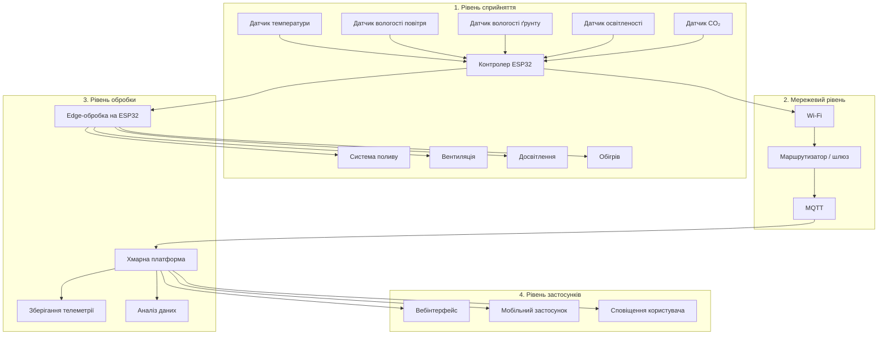

# Практична робота №1  
## Вступ до IoT та SMART-технологій

**Дисципліна:** Технології IoT та SMART-технології  
**Тема:** Вступ до IoT та SMART-технологій  
**Варіант:** 1 — Розумна теплиця  

---

## Мета роботи

Навчитися аналізувати та проєктувати IoT-систему на рівні архітектури: визначати склад пристроїв, обирати місце обробки даних, оцінювати ризики безпеки та обґрунтовувати технічні рішення відповідно до вимог поставленої задачі.

---

## 1. Опис системи

У межах практичної роботи проєктується IoT-система автоматичного контролю та керування теплицею площею **200 м²**.

Система повинна постійно отримувати інформацію про стан середовища в теплиці, аналізувати отримані дані та автоматично керувати обладнанням для підтримання необхідних умов вирощування рослин.

Контролюються такі параметри:

- температура повітря;
- вологість повітря;
- вологість ґрунту;
- рівень освітленості;
- концентрація CO₂.

На основі отриманих даних система автоматично керує:

- поливом;
- вентиляцією;
- досвітленням;
- обігрівом.

Система є IoT-системою, оскільки вона не лише збирає та передає інформацію, а й самостійно виконує фізичні дії залежно від отриманих показників.

---

## 2. Принцип роботи системи

Датчики, розташовані всередині теплиці, періодично вимірюють параметри навколишнього середовища.

Отримані значення передаються на локальний контролер. Контролер порівнює їх із заданими допустимими межами та приймає рішення про необхідність увімкнення або вимкнення відповідного обладнання.

Наприклад:

- при недостатній вологості ґрунту вмикається система поливу;
- при надмірній температурі активується вентиляція;
- при недостатній освітленості вмикається досвітлення;
- при низькій температурі запускається система обігріву;
- показники CO₂ використовуються для оцінювання стану повітря та роботи вентиляції.

Паралельно результати вимірювань передаються до хмарної системи, де вони зберігаються та можуть використовуватися для побудови графіків, статистики й аналізу роботи теплиці.

Користувач отримує доступ до інформації через вебінтерфейс або мобільний застосунок.
---

## 3. Склад системи

До складу системи входять датчики, локальний контролер, мережеве обладнання, виконавчі механізми та засоби взаємодії з користувачем.

| Пристрій | Що вимірює або робить | Де розміщено |
|---|---|---|
| Датчик температури | Вимірює температуру повітря | Усередині теплиці |
| Датчик вологості повітря | Вимірює відносну вологість повітря | Усередині теплиці |
| Датчик вологості ґрунту | Визначає рівень вологості ґрунту | У ґрунті біля кореневої системи рослин |
| Датчик освітленості | Вимірює рівень природного освітлення | Усередині теплиці |
| Датчик CO₂ | Вимірює концентрацію вуглекислого газу | Усередині теплиці |
| Контролер ESP32 | Збирає дані з датчиків і виконує локальну логіку керування | У захищеному блоці керування |
| Система поливу | Подає воду до рослин | Уздовж грядок |
| Вентиляція | Забезпечує провітрювання та зниження температури | У верхній або боковій частині теплиці |
| Досвітлення | Забезпечує додаткове освітлення | Над зонами вирощування рослин |
| Система обігріву | Підтримує необхідну температуру | Усередині теплиці |
| Маршрутизатор / шлюз | Передає дані між ESP32 і зовнішньою мережею | Біля блоку керування або поруч із теплицею |

---

## 4. Архітектура IoT-системи

Для системи використовується чотирирівнева модель архітектури IoT:

1. рівень сприйняття;
2. мережевий рівень;
3. рівень обробки;
4. рівень застосунків.

### Архітектурна діаграма

---

## 5. Вибір місця обробки даних

Для системи розумної теплиці використовується комбінований підхід **Edge + Cloud**.

Критичні рішення виконуються локально на ESP32. Це дозволяє системі швидко реагувати та працювати навіть при втраті зв'язку з хмарою.

Вимога до затримки локальної реакції — **не більше 500 мс**.

Edge використовується для керування поливом, вентиляцією, досвітленням та обігрівом. Хмара використовується для зберігання історії вимірювань, аналітики та віддаленого моніторингу.

---

## 6. Робота при втраті зв'язку з хмарою

При втраті інтернет-з'єднання ESP32 продовжує отримувати дані від датчиків і керувати обладнанням за локальними правилами.

Телеметрія тимчасово зберігається локально. Після відновлення зв'язку накопичені дані передаються до хмари.

Таким чином, основні функції теплиці не залежать від постійного доступу до інтернету.

---

## 7. Оцінка добового обсягу телеметрії

Дані передаються один раз на хвилину одним повідомленням, яке містить показники температури, вологості повітря, вологості ґрунту, освітленості та CO₂.

Кількість повідомлень за добу:

`24 × 60 = 1440 повідомлень`

Приблизний розмір одного повідомлення — **120 байт**.

Добовий обсяг:

`1440 × 120 = 172800 байт`

`172800 / 1024 ≈ 168,75 КБ`

Отже, система передає приблизно **169 КБ телеметрії на добу**.

За 30 діб це становить приблизно:

`169 × 30 ≈ 5 МБ`

---

## 8. Безпека

| Загроза | Можливий наслідок | Захід протидії |
|---|---|---|
| Несанкціонований доступ до керування | Неправильна робота поливу, вентиляції або обігріву | Автентифікація та контроль доступу |
| Перехоплення або підміна телеметрії | Отримання системою неправильних даних | Шифрування з'єднання за допомогою TLS |
| Компрометація облікових даних пристрою | Сторонній доступ до системи | Унікальні облікові дані для кожного пристрою |
| Підроблене оновлення | Виконання шкідливого програмного забезпечення | Використання підписаних оновлень |

При втраті зв'язку або некоректній роботі датчиків виконавчі механізми повинні переходити у безпечний стан. Наприклад, насос не повинен залишатися безконтрольно увімкненим.

---

## Висновок

У практичній роботі спроєктовано IoT-систему для автоматизованої теплиці площею 200 м².

Система контролює температуру, вологість повітря та ґрунту, освітленість і концентрацію CO₂ та керує поливом, вентиляцією, досвітленням і обігрівом.

Для обробки даних використано підхід **Edge + Cloud**. Локальна обробка забезпечує швидку реакцію та автономну роботу, а хмара використовується для зберігання й аналізу даних.

---

## Джерела

1. Лекція 1 «Вступ до IoT та SMART-технологій». Навчальні матеріали дисципліни. Дата звернення: 01.11.2026.
2. ITU-T Y.4000/Y.2060 — Overview of the Internet of Things. Дата звернення: 01.11.2026.
3. NIST IR 8228 — Considerations for Managing Internet of Things (IoT) Cybersecurity and Privacy Risks. Дата звернення: 01.11.2026.
4. ENISA — Baseline Security Recommendations for IoT. Дата звернення: 01.11.2026.
5. MQTT — офіційна специфікація. Дата звернення: 01.11.2026.
6. Mermaid — офіційна документація. Дата звернення: 01.11.2026.

---

## Декларація використання штучного інтелекту

**Інструмент:** ChatGPT (OpenAI).

**Мета використання:** пояснення окремих технічних моментів, перевірка структури README.md та допомога із синтаксисом Mermaid.

**Промпт:** надано умову практичної роботи та матеріали лекції з проханням допомогти розібрати вимоги до IoT-системи.

**Використані фрагменти:** окремі формулювання тексту та підказки щодо структури документа.

**Власне доопрацювання:** побудовано архітектурну Mermaid-діаграму, перевірено логіку системи, розрахунок телеметрії та остаточне оформлення README.md.
